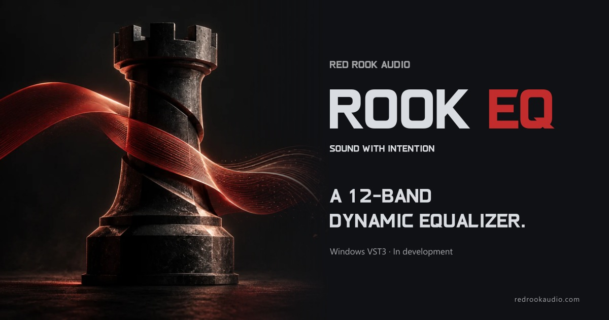
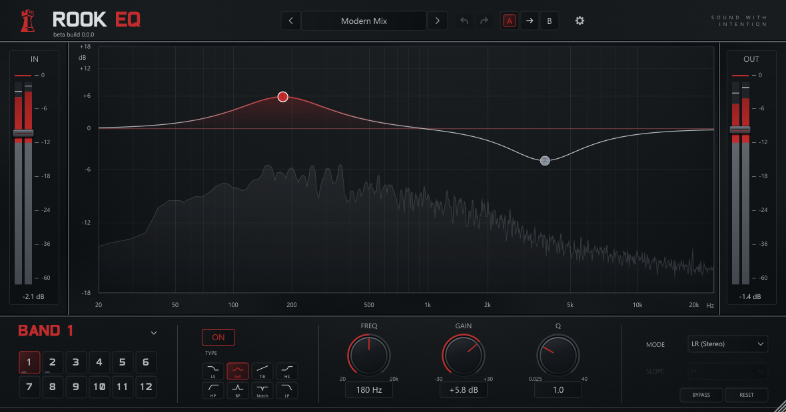

# Rook EQ

**A 12-band dynamic equalizer by Clint Wagoner.**

Shape a track, control a problem frequency, or work on the center and sides of a mix. Rook EQ brings direct curve editing, dynamic bands, and band listening into one interface.

*Development preview with example EQ settings and meter levels.*

## Features

- **12 EQ bands** with bell, shelf, tilt, notch, band-pass, low-cut, and high-cut filters.
- **Dynamic EQ** with threshold, attack, release, and external sidechain control on gain-based filters.
- **Stereo, Mid, and Side processing** for full-mix and targeted stereo work.
- **Band listening** to isolate a frequency region and sweep it by ear.
- **Output spectrum analyzer** with adjustable resolution, smoothing, and peak hold.
- **Presets, input/output trims, and five interface themes.**

## Download

**Free for Windows, 64-bit VST3. Version 1.1.1.**

Choose the Windows installer or the manual VST3 ZIP on Gumroad. Enter $0 to download for free. You can leave an optional payment to support the project.

The installer is unsigned. See the included README for Windows security prompts and installation instructions. The ZIP contains a single VST3 file to copy into your VST3 folder.

Rook EQ is free to use in personal and commercial audio work. The plugin source is private. Support and future updates are not guaranteed.

## Documentation and feedback

- [Clint Wagoner](https://clintwagoner.com/)
- [Quick start and controls](docs/user-guide.md)
- [Interface screenshots](docs/screenshots.md)
- [Support and bug reports](SUPPORT.md)
- [Report a bug](https://github.com/cwagoner78/RookEQ/issues/new?template=bug_report.yml)
- [Suggest a feature](https://github.com/cwagoner78/RookEQ/issues/new?template=feature_request.yml)

Copyright 2026 Clint Wagoner. All rights reserved.
